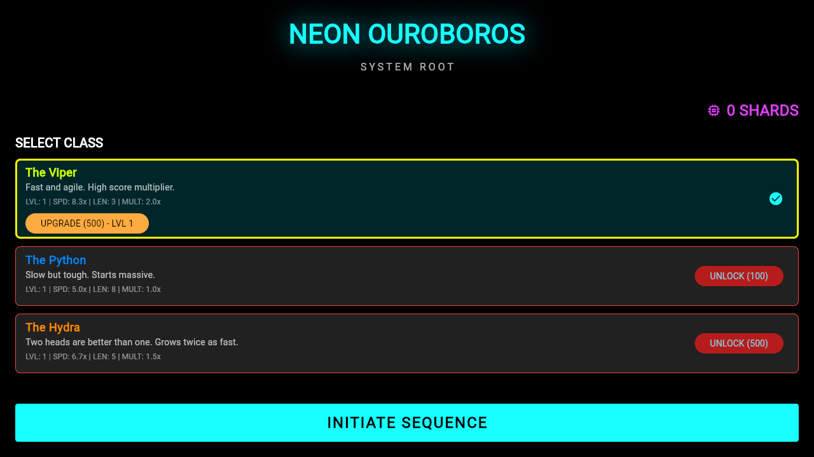
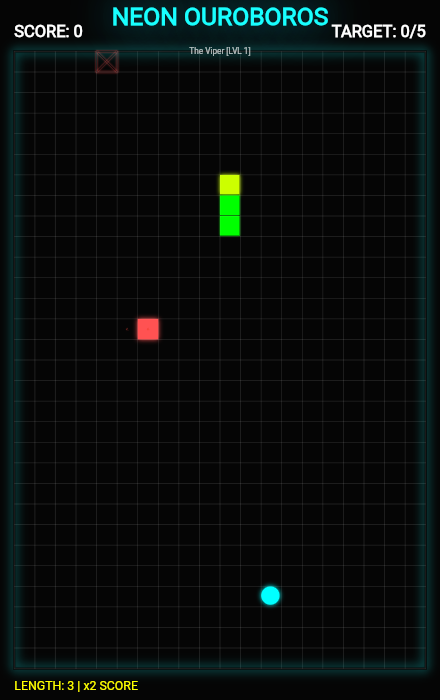
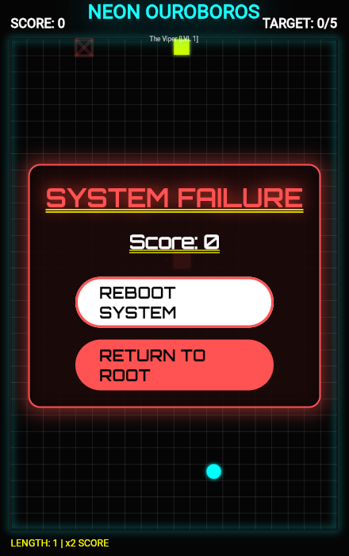

# Neon Ouroboros: System Override

> *A Cyberpunk Snake Roguelite*

**Neon Ouroboros** is a high-octane, cyberpunk-themed twist on the classic Snake game. Hack the system, devour data shards, and breach firewalls to ascend through the security layers of the mainframe.

**▶ [Play it in your browser](https://snake-flutter.vercel.app/)**

## 📸 Screenshots



| Gameplay | Game Over |
| :---: | :---: |
|  |  |

## 🎮 Features

- **Roguelite Progression:** Unlock new Snake Classes (Viper, Python, Hydra) with unique stats and abilities.
- **Dynamic Gameplay:**
  - **Firewalls:** Eat enough data shards to open the firewall and advance to the next zone.
  - **Enemies:** Avoid or destroy security drones patrolling the grid.
  - **Power-ups:** Utilize Slow-Mo, Nukes, and Shields to survive.
  - **Combo System:** Chain food pickups within 2 seconds for score multipliers!
- **Upgrade System:** Draft powerful upgrades between levels (Speed Demon, Crypto Miner, Magnetize, Ghost Protocol).
- **Universal Control:** Full support for Keyboard, Touch, and Gamepad (Xbox/PS/Generic) on Windows, Web, and Android.
- **Retro-Futuristic Aesthetic:** Neon glow graphics, CRT effects, and a pumping synthwave soundtrack.

## 🕹️ How to Play

### Controls

| Action | Keyboard | Gamepad | Touch |
| :--- | :--- | :--- | :--- |
| **Move** | Arrow Keys | D-Pad / Left Stick | Swipe |
| **Pause** | P | Start / Menu | Tap Center |
| **Select** | Enter / Space | A / Cross | Tap Button |
| **Back** | Esc | B / Circle | Back Button |

### Objective

1. **Consume Data:** Eat the cyan data shards to grow and increase your score.
2. **Build Combos:** Chain pickups within 2 seconds for bonus multipliers (x2, x3, x4...).
3. **Breach Security:** Fill the Target meter to open the Firewall (Exit).
4. **Survive:** Avoid crashing into walls, your own tail, or red security drones.
5. **Evolve:** Complete levels to draft upgrades and become unstoppable.

### Tips

- **Speed Demon:** Faster movement = easier combos, but harder control.
- **Ghost Protocol:** Grants 3 charges to phase through obstacles.
- **Magnetize:** Increases pickup radius - collect food without exact positioning.
- **Crypto Miner:** Doubles your score multiplier permanently.

## 🛠️ Build & Deploy

This project is built with [Flutter](https://flutter.dev) and the [Flame Engine](https://flame-engine.org).

### Prerequisites

- Flutter SDK 3.50+ (stable), which includes Dart 3.14

### Running Locally

```bash
# Get dependencies
flutter pub get

# Run on Windows
flutter run -d windows

# Run on Web (Chrome)
flutter run -d chrome
```

### Building for Production

**Windows:**

```bash
flutter build windows
# Output: build/windows/x64/runner/Release/
```

**Web:**

```bash
flutter build web --release
# Output: build/web/
# Hosting under a sub-path? Add: --base-href /your-hosting-path/
```

**Android:**

```bash
flutter build apk --release
# Output: build/app/outputs/flutter-apk/app-release.apk
```

### Deploying to Vercel

The repo includes a `vercel.json`, so importing it into [Vercel](https://vercel.com) needs no extra setup. Vercel's build image has no Flutter SDK, so `scripts/vercel-build.sh` downloads the pinned Flutter version and builds `build/web`.

- **Keep versions in step:** after upgrading Flutter locally, bump `FLUTTER_VERSION` in the script, or set it as an environment variable in the Vercel project.
- **Faster deploys:** build locally and run `vercel deploy --prebuilt` to skip the SDK download.
- **Test the build locally:** Vercel builds on Amazon Linux 2023, so the script can be checked in Docker:

  ```bash
  docker run --rm -v "$PWD":/app -w /app amazonlinux:2023 bash scripts/vercel-build.sh
  ```

## 🌐 Web demo

[snake-flutter.vercel.app](https://snake-flutter.vercel.app/)

## 📦 Dependencies

- `flame`: Game engine core.
- `gamepads`: Universal gamepad support.
- `window_manager`: Desktop window control.
- `google_fonts`: Typography.
- `flame_audio`: Sound effects and music.
- `hive` / `hive_flutter`: Save data persistence.
- `flutter_riverpod`: State management.
- `material_ui`: Material widgets (replaces the deprecated `package:flutter/material.dart`).

## 🐛 Known Issues

- **Windows Audio Warning:** You may see threading warnings from `audioplayers` in the console. These are harmless and don't affect gameplay.
- **Debug Mode:** Closing the game in debug mode may show errors - this is normal. Release builds exit cleanly.

## 🎯 Gameplay Tips

- **Aggressive Play:** Risk getting close to enemies for faster food chains and higher combos.
- **Upgrade Synergy:** Combine Speed Demon + Magnetize for maximum combo potential.
- **Ghost Protocol:** Save charges for tight situations - you get 3 per pickup.
- **Class Selection:** Python starts long and slow but tough; Hydra grows twice as fast.

## 📄 License

MIT License - Hack away!
